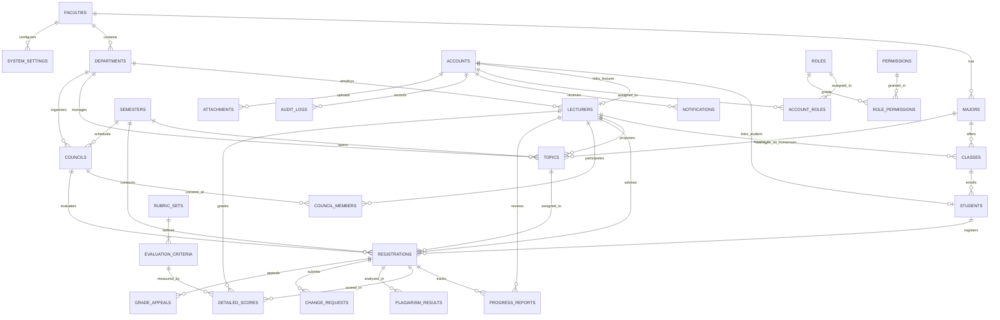

# ĐẶC TẢ THIẾT KẾ CƠ SỞ DỮ LIỆU (DATABASE SPECIFICATION)
## HỆ THỐNG QUẢN LÝ ĐỒ ÁN TỐT NGHIỆP UTC2 (UTC2-DAMS)

> **Cơ sở dữ liệu:** PostgreSQL 16+  
> **ORM:** Prisma Client / TypeORM  
> **Quy ước đặt tên:** Tiếng Anh (English) – Bảng: Số nhiều snake_case (e.g. `topics`, `registrations`), Cột: snake_case (e.g. `advisor_score`, `is_locked`).  
> **Tổng số bảng:** 28 Bảng (15 Bảng Nghiệp vụ cốt lõi + 4 Bảng Dynamic RBAC + 9 Bảng Mở rộng Web Application).

---

## 🗺️ 1. SƠ ĐỒ THỰC THỂ LIÊN KẾT (MERMAID ER DIAGRAM)

---

## 📚 2. TỪ ĐIỂN ÁNH XẠ THỰC THỂ (ENGLISH ⟷ VIETNAMESE)

### 15 Bảng Nghiệp vụ cốt lõi (Core Domain Tables)
| STT | Tên Bảng Tiếng Anh | Tên Bảng Gốc (SRS) | Ý Nghĩa Nghiệp Vụ | Khóa Chính |
| :---: | :--- | :--- | :--- | :---: |
| 1 | `faculties` | `khoa` | Quản lý danh mục Khoa | `id` (UUID) |
| 2 | `majors` | `nganh` | Ngành đào tạo trực thuộc Khoa | `id` (UUID) |
| 3 | `departments` | `bo_mon` | Bộ môn chuyên môn thuộc Khoa | `id` (UUID) |
| 4 | `lecturers` | `giang_vien` | Hồ sơ Giảng viên & Định mức hướng dẫn | `id` (UUID) |
| 5 | `classes` | `lop` | Lớp sinh viên chính quy | `id` (UUID) |
| 6 | `students` | `sinh_vien` | Hồ sơ Sinh viên (Tín chỉ tích lũy, GPA) | `id` (UUID) |
| 7 | `semesters` | `hoc_ky` | Đợt/Học kỳ và các mốc hạn đăng ký, nộp bài, BV | `id` (UUID) |
| 8 | `topics` | `de_tai` | Đề tài đồ án (Đề xuất, thẩm định, phê duyệt) | `id` (UUID) |
| 9 | `councils` | `hoi_dong` | Hội đồng bảo vệ đồ án (Ngày, Giờ, Địa điểm) | `id` (UUID) |
| 10 | `registrations` | `dang_ky` | **Bảng trung tâm**: Quá trình thực hiện đồ án của SV | `id` (UUID) |
| 11 | `council_members` | `thanh_vien_hoi_dong` | Phân công vai trò trong HĐ (Chủ tịch, Thư ký, UV) | `id` (UUID) |
| 12 | `progress_reports` | `tien_do` | Báo cáo tiến độ tuần & Nhận xét của GVHD | `id` (UUID) |
| 13 | `rubric_sets` | `bo_tieu_chi` | Bộ tiêu chí đánh giá (Tổng trọng số $= 100\%$) | `id` (UUID) |
| 14 | `evaluation_criteria` | `tieu_chi_cham` | Chi tiết từng tiêu chí chấm điểm và trọng số | `id` (UUID) |
| 15 | `detailed_scores` | `phieu_diem_chi_tiet` | Điểm từng thành viên HĐ chấm theo từng tiêu chí | `id` (UUID) |

### 4 Bảng Phân quyền Động (Dynamic RBAC Tables)
| STT | Tên Bảng Tiếng Anh | Ý Nghĩa Kỹ Thuật | Khóa Chính |
| :---: | :--- | :--- | :---: |
| 16 | `roles` | Danh mục vai trò động (ADMIN, STUDENT, LECTURER, DEAN, HOD...) | `id` (UUID) |
| 17 | `permissions` | Danh mục quyền hạn chi tiết (`topics.create`, `scores.lock`...) | `id` (UUID) |
| 18 | `role_permissions` | Bảng trung gian gán quyền chi tiết vào từng vai trò | `(role_id, permission_id)` |
| 19 | `account_roles` | Bảng trung gian gán vai trò kèm theo Scope (Khoa/Bộ môn) cho Account | `id` (UUID) |

### 9 Bảng Mở rộng Web Application (Extension Tables)
| STT | Tên Bảng Tiếng Anh | Tên Bảng Gốc (SRS) | Ý Nghĩa Kỹ Thuật | Khóa Chính |
| :---: | :--- | :--- | :--- | :---: |
| 20 | `accounts` | `tai_khoan` | Tài khoản xác thực (Username, Password Hash, Tokens) | `id` (UUID) |
| 21 | `attachments` | `tep_dinh_kem` | Quản lý metadata file PDF/Word lưu trên MinIO/S3 | `id` (UUID) |
| 22 | `plagiarism_results` | `ket_qua_trung_lap` | Tỷ lệ % trùng lặp & chi tiết đoạn trùng khớp | `id` (UUID) |
| 23 | `status_histories` | `lich_su_trang_thai` | Ghi vết mọi lần chuyển trạng thái hồ sơ/đề tài | `id` (UUID) |
| 24 | `change_requests` | `yeu_cau_thay_doi` | Đơn xin đổi đề tài / đổi GVHD / gia hạn muộn | `id` (UUID) |
| 25 | `grade_appeals` | `khieu_nai_diem` | Tiếp nhận và xử lý đơn phúc khảo điểm | `id` (UUID) |
| 26 | `notifications` | `thong_bao` | Thông báo In-app & trạng thái gửi Email SMTP | `id` (UUID) |
| 27 | `audit_logs` | `nhat_ky_he_thong` | Nhật ký kỹ thuật ghi vết toàn bộ request CUD | `id` (UUID) |
| 28 | `system_settings` | `cau_hinh_he_thong` | Tham số động: Ngưỡng trùng lặp, hệ số tính điểm | `id` (UUID) |

---

## 🔒 3. CÁC RÀNG BUỘC TOÀN VẸN CỐT LÕI (DATABASE CONSTRAINTS)

1. **Ràng buộc Duy nhất (Unique Constraints):**
   * `UNIQUE(student_id, semester_id)`: Một sinh viên chỉ được đăng ký tối đa 1 đồ án trong cùng một học kỳ (BR-01).
   * `UNIQUE(registration_id, week_number)`: Mỗi lượt đăng ký chỉ có duy nhất 1 báo cáo cho tuần tương ứng (BR-05).
   * `UNIQUE(registration_id, criterion_id, lecturer_id)`: Mỗi giảng viên chỉ có đúng 1 điểm cho 1 tiêu chí của 1 sinh viên (BR-08).
   * `UNIQUE(rubric_set_id, code)`: Mã tiêu chí trong một bộ không được trùng nhau.
   * `UNIQUE(code)` trong `roles` và `permissions`.
2. **Ràng buộc Miền giá trị (Check Constraints):**
   * Điểm số: `CHECK (score BETWEEN 0.00 AND 10.00)`
   * Tỷ lệ trùng lặp: `CHECK (similarity_percentage BETWEEN 0.00 AND 100.00)`
   * Trọng số tiêu chí: `CHECK (weight > 0.00 AND weight <= 100.00)`
   * Giờ bảo vệ: `CHECK (end_time > start_time)`
   * Ngày học kỳ: `CHECK (end_date >= start_date)`
   * Định mức GVHD: `CHECK (max_advising_quota > 0)`
