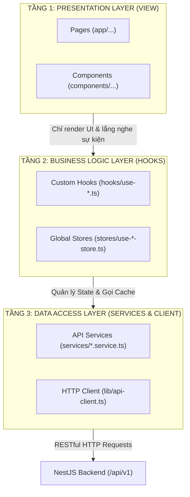

# 🎨 HƯỚNG DẪN & TIÊU CHUẨN KIẾN TRÚC CODE FRONTEND (FRONTEND CODING GUIDELINES)
## HỆ THỐNG WEB QUẢN LÝ ĐỒ ÁN TỐT NGHIỆP UTC2 (UTC2-DAMS)

> **Tài liệu này là bộ quy tắc kiến trúc Frontend bắt buộc (Mandatory Frontend Architecture Rules)** áp dụng cho toàn bộ quá trình phát triển mã nguồn tại thư mục `apps/frontend/`. Mọi thành viên và Pull Request / Commit đều phải tuân thủ nghiêm ngặt các nguyên tắc dưới đây.

---

## 📑 MỤC LỤC
1. [Nguyên Tắc Kiến Trúc Cốt Lõi (Clean Frontend Architecture)](#1-nguyên-tắc-kiến-trúc-cốt-lõi-clean-frontend-architecture)
2. [Cấu Trúc Thư Mục Chuẩn (`apps/frontend/src/`)](#2-cấu-trúc-thư-mục-chuẩn-appsfrontendsrc)
3. [Quy Chuẩn Tách Hook Ra Khỏi View (Separation of Concerns)](#3-quy-chuẩn-tách-hook-ra-khỏi-view-separation-of-concerns)
4. [Design System, Bảng Màu UTC2 & Style Chung](#4-design-system-bảng-màu-utc2--style-chung)
5. [Quy Chuẩn Tầng Data Access & API Client (Axios + TanStack Query)](#5-quy-chuẩn-tầng-data-access--api-client-axios--tanstack-query)
6. [Quản Lý Form & Validation (React Hook Form + Zod)](#6-quản-lý-form--validation-react-hook-form--zod)
7. [Quản Lý State Toàn Cục (Zustand Store)](#7-quản-lý-state-toàn-cục-zustand-store)
8. [Quy Chuẩn Đặt Tên & Viết Mã Nguồn (Naming & Coding Conventions)](#8-quy-chuẩn-đặt-tên--viết-mã-nguồn-naming--coding-conventions)

---

## 1. NGUYÊN TẮC KIẾN TRÚC CỐT LÕI (CLEAN FRONTEND ARCHITECTURE)

Hệ thống Frontend tuân thủ mô hình phân tầng **Clean Architecture** 3 lớp độc lập:



### 4 Điều Luật Thép:
1. **View (Page / Component) là Pure Presentation:**
   * Chỉ nhận `props`, hiển thị JSX/HTML và gọi lại các handler (`onClick`, `onSubmit`).
   * **Tuyệt đối không:** Gọi trực tiếp `axios`/`fetch`, thực hiện tính toán nghiệp vụ hay xử lý chuỗi logic phức tạp trong View.
2. **Business Logic & State tập trung vào Custom Hooks:**
   * Mọi màn hình có dữ liệu động hoặc tương tác nghiệp vụ đều phải có một Custom Hook tương ứng (ví dụ: `useStudentTopics`, `useProgressSubmission`, `useCouncilEvaluation`).
   * Hook chịu trách nhiệm: Gọi TanStack Query (`useQuery`, `useMutation`), format dữ liệu, mở/đóng modal, kiểm tra điều kiện quyền.
3. **Data Access đóng gói trong Service:**
   * Không viết URL hay config HTTP trực tiếp trong Hook hay Component. Toàn bộ endpoints phải được tập trung tại `services/<domain>.service.ts`.
4. **TUYỆT ĐỐI KHÔNG HARDCODE – 100% DỮ LIỆU ĐƯỢC GỌI TỪ BACKEND API:**
   * **CẤM Hardcode Mock Data / Dữ liệu mẫu:** Tuyệt đối không tạo các mảng giả như `const mockTopics = [...]`, `const sampleStudents = [...]`, `const dummyGrades = [...]` trong code. Mọi thông tin hiển thị trên Card, Table, Modal phải đến từ phản hồi của API Backend.
   * **CẤM Hardcode Danh mục chọn (Dropdown/Select Options):** Danh sách Học kỳ, Khoa, Ngành, Bộ môn, Giảng viên phải được fetch từ API danh mục (`/academic/semesters`, `/academic/departments`...), không tự gõ cứng danh sách tĩnh.
   * **CẤM Hardcode URL & Cấu hình:** Base API URL bắt buộc lấy từ `process.env.NEXT_PUBLIC_API_URL`. Tuyệt đối không viết cứng `http://localhost:4000` hay IP máy chủ trong mã nguồn.
   * **CẤM Magic Strings:** Các trạng thái đề tài (`APPROVED`, `PENDING`, `QUALIFIED_DEFENSE`...), vai trò (`STUDENT`, `LECTURER`...) phải được định nghĩa bằng TypeScript Enum hoặc Constants tập trung (`src/constants/`).
   * **Bắt buộc hỗ trợ đầy đủ 3 trạng thái API:** Vì gọi dữ liệu thật, mọi trang đều phải xử lý đầy đủ:
     * `isLoading`: Hiển thị Skeleton Loader mượt mà (không để màn hình trắng).
     * `data.length === 0`: Hiển thị Component EmptyState ("Chưa có dữ liệu đề tài trong học kỳ này").
     * `isError`: Hiển thị thông báo lỗi rõ ràng và nút "Thử lại" (Retry).

---

## 2. CẤU TRÚC THƯ MỤC CHUẨN (`apps/frontend/src/`)

```text
apps/frontend/src/
├── app/                          # Next.js 15 App Router (Chỉ chứa View & Routing)
│   ├── (auth)/                   # Phân hệ Xác thực (Layout riêng)
│   │   ├── login/page.tsx
│   │   └── layout.tsx
│   ├── (dashboard)/              # Phân hệ Quản trị & Điều hành chính
│   │   ├── layout.tsx            # Master Layout (Header + Dynamic Sidebar theo Role)
│   │   ├── page.tsx              # Tổng quan Dashboard
│   │   ├── student/              # Phân hệ Sinh viên
│   │   │   ├── topics/page.tsx   # Đăng ký đề tài
│   │   │   ├── progress/page.tsx # Báo cáo tiến độ tuần & bài nộp
│   │   │   └── grades/page.tsx   # Xem điểm quá trình, phản biện, hội đồng
│   │   ├── lecturer/             # Phân hệ Giảng viên (Hướng dẫn / Phản biện / Hội đồng)
│   │   │   ├── topics/page.tsx   # Đề xuất & quản lý đề tài
│   │   │   ├── reviews/page.tsx  # Chấm điểm phản biện
│   │   │   └── councils/page.tsx # Chấm điểm Hội đồng Rubric
│   │   └── management/           # Phân hệ Trưởng Bộ môn & Giáo vụ Khoa
│   │       ├── topics-approval/  # Duyệt đề tài cấp Bộ môn
│   │       ├── reviewer-assign/  # Phân công Giảng viên phản biện
│   │       └── councils/         # Thành lập Hội đồng & Chốt điểm tổng kết UTC2
│   ├── globals.css               # Design Tokens & Tailwind Base
│   └── layout.tsx                # Root Layout (QueryClientProvider, Providers)
│
├── components/                   # UI Components dùng chung
│   ├── ui/                       # Base Atomic Components (Button, Input, Badge, Table, Modal, Card)
│   ├── shared/                   # Header, Sidebar, UserDropdown, Breadcrumb, Pagination
│   └── feedback/                 # EmptyState, ErrorBoundary, LoadingSkeleton, ConfirmDialog
│
├── hooks/                        # Custom Hooks chứa toàn bộ logic (Mỗi màn hình 1 Hook)
│   ├── use-auth.ts               # Login, Logout, Session check
│   ├── use-student-topics.ts     # Logic đăng ký đề tài sinh viên
│   ├── use-progress-report.ts    # Logic nộp báo cáo tuần & nộp toàn văn
│   ├── use-reviewer.ts           # Logic phân công & nhập điểm phản biện
│   └── use-council-scoring.ts    # Logic nhập điểm Rubric & chốt điểm UTC2
│
├── lib/                          # Cấu hình Thư viện Lõi
│   ├── api-client.ts             # Axios instance + Request/Response Interceptors (Token Refresh)
│   ├── query-client.ts           # Cấu hình TanStack React Query Client
│   └── utils.ts                  # cn() helper (clsx + tailwind-merge)
│
├── services/                     # Tầng API Client gọi Backend RESTful
│   ├── auth.service.ts
│   ├── academic.service.ts
│   ├── topics.service.ts
│   ├── registrations.service.ts
│   ├── progress.service.ts
│   └── councils.service.ts
│
├── stores/                       # Zustand Global State
│   ├── use-auth-store.ts         # User info, Roles, Positions, Active token
│   └── use-app-store.ts          # Học kỳ hiện tại (active semester), Sidebar collapse state
│
└── types/                        # 100% Strict TypeScript Interfaces & DTOs
    ├── auth.ts
    ├── topic.ts
    ├── registration.ts
    ├── progress.ts
    └── grading.ts
```

---

## 3. QUY CHUẨN TÁCH HOOK RA KHỎI VIEW (SEPARATION OF CONCERNS)

### 📌 Quy tắc:
* File `page.tsx` hoặc Component **chỉ dài tối đa $\le 150$ dòng**.
* Toàn bộ `useQuery`, `useMutation`, `useState` điều khiển modal, validation schema và event handlers được đóng gói trong một file hook tại `src/hooks/use-<tên-chức-năng>.ts`.

### 🔍 Ví dụ Minh Họa Chuẩn:

#### 1. Tầng Service (`src/services/topics.service.ts`):
```typescript
import { apiClient } from '@/lib/api-client';
import { Topic, TopicRegistrationResponse } from '@/types/topic';

export const topicsService = {
  getApprovedTopics: async (semesterId?: string): Promise<Topic[]> => {
    const res = await apiClient.get<Topic[]>('/topics', {
      params: { semesterId, status: 'APPROVED_BY_DEAN' },
    });
    return res.data;
  },

  registerTopic: async (topicId: string): Promise<TopicRegistrationResponse> => {
    const res = await apiClient.post<TopicRegistrationResponse>('/registrations', { topicId });
    return res.data;
  },
};
```

#### 2. Tầng Custom Hook (`src/hooks/use-student-topics.ts`):
```typescript
import { useState } from 'react';
import { useQuery, useMutation, useQueryClient } from '@tanstack/react-query';
import { topicsService } from '@/services/topics.service';
import { useAuthStore } from '@/stores/use-auth-store';

export function useStudentTopics() {
  const queryClient = useQueryClient();
  const currentSemester = useAuthStore((s) => s.currentSemester);
  const [selectedTopicId, setSelectedTopicId] = useState<string | null>(null);
  const [errorMessage, setErrorMessage] = useState<string | null>(null);

  // 1. Fetch danh sách đề tài
  const { data: topics = [], isLoading } = useQuery({
    queryKey: ['approved-topics', currentSemester?.id],
    queryFn: () => topicsService.getApprovedTopics(currentSemester?.id),
    enabled: !!currentSemester?.id,
  });

  // 2. Mutation đăng ký đề tài
  const registerMutation = useMutation({
    mutationFn: (topicId: string) => topicsService.registerTopic(topicId),
    onSuccess: () => {
      setSelectedTopicId(null);
      setErrorMessage(null);
      queryClient.invalidateQueries({ queryKey: ['approved-topics'] });
      queryClient.invalidateQueries({ queryKey: ['student-registration'] });
    },
    onError: (err: any) => {
      setErrorMessage(err.response?.data?.message || 'Đăng ký đề tài thất bại');
    },
  });

  return {
    topics,
    isLoading,
    isSubmitting: registerMutation.isPending,
    selectedTopicId,
    errorMessage,
    openRegisterModal: (id: string) => { setSelectedTopicId(id); setErrorMessage(null); },
    closeRegisterModal: () => { setSelectedTopicId(null); setErrorMessage(null); },
    confirmRegister: () => {
      if (selectedTopicId) registerMutation.mutate(selectedTopicId);
    },
  };
}
```

#### 3. Tầng View (`src/app/(dashboard)/student/topics/page.tsx`):
```tsx
'use client';

import React from 'react';
import { useStudentTopics } from '@/hooks/use-student-topics';
import { Button } from '@/components/ui/button';
import { Badge } from '@/components/ui/badge';
import { ConfirmDialog } from '@/components/feedback/confirm-dialog';

export default function StudentTopicsPage() {
  const {
    topics,
    isLoading,
    isSubmitting,
    selectedTopicId,
    errorMessage,
    openRegisterModal,
    closeRegisterModal,
    confirmRegister,
  } = useStudentTopics();

  if (isLoading) return <div className="p-8 text-center text-slate-500">Đang tải đề tài...</div>;

  return (
    <div className="space-y-6">
      <div>
        <h1 className="text-2xl font-bold text-utc2-primary">Danh Sách Đề Tài Tốt Nghiệp</h1>
        <p className="text-sm text-slate-500">Chọn đề tài phù hợp với định hướng chuyên ngành của bạn</p>
      </div>

      <div className="grid grid-cols-1 md:grid-cols-2 lg:grid-cols-3 gap-6">
        {topics.map((t) => (
          <div key={t.id} className="rounded-xl border border-slate-200 bg-white p-5 shadow-sm space-y-3">
            <Badge variant="info">{t.code}</Badge>
            <h3 className="font-semibold text-slate-800 line-clamp-2">{t.titleVi}</h3>
            <p className="text-xs text-slate-500">GVHD: {t.proposerLecturer?.fullName}</p>
            <Button
              className="w-full"
              variant="primary"
              onClick={() => openRegisterModal(t.id)}
            >
              Đăng Ký Đề Tài
            </Button>
          </div>
        ))}
      </div>

      {/* Modal xác nhận */}
      <ConfirmDialog
        isOpen={!!selectedTopicId}
        title="Xác nhận đăng ký đề tài"
        message="Bạn có chắc chắn muốn đăng ký đề tài này? Mỗi sinh viên chỉ được đăng ký tối đa 1 đề tài."
        errorMessage={errorMessage}
        isLoading={isSubmitting}
        onConfirm={confirmRegister}
        onCancel={closeRegisterModal}
      />
    </div>
  );
}
```

---

## 4. DESIGN SYSTEM, BẢNG MÀU UTC2 & STYLE CHUNG

### 🎨 1. Bảng Màu Thương Hiệu UTC2 (`Design Tokens`):
Hệ thống sử dụng tông màu chủ đạo của trường Đại học Giao thông Vận tải Phân hiệu TP.HCM:

| Token | Hex Code | Ứng Dụng |
| :--- | :--- | :--- |
| `utc2-primary` | `#004085` | Màu xanh navy chủ đạo: Header, Sidebar Item Active, Nút Primary, Heading |
| `utc2-primary-hover` | `#003366` | Trạng thái hover của nút primary |
| `utc2-accent` | `#0284c7` | Xanh cobalt bổ trợ: Icons, Links, Focus ring |
| `utc2-surface` | `#f8fafc` | Màu nền Dashboard tổng thể (Slate 50) |
| `utc2-card` | `#ffffff` | Màu nền các hộp Card, Modal, Dropdown |
| `utc2-border` | `#e2e8f0` | Màu viền phân cách tiêu chuẩn (Slate 200) |

### 🏷️ 2. Màu Sắc Trạng Thái Nghiệp Vụ Chuẩn (Badges):
* **Chờ duyệt / Nháp (`DRAFT`, `PENDING`):** `bg-amber-50 text-amber-700 border-amber-200`
* **Đã duyệt / Hoàn thành (`APPROVED`, `COMPLETED`):** `bg-emerald-50 text-emerald-700 border-emerald-200`
* **Từ chối / Trượt (`REJECTED`, `FAILED`):** `bg-rose-50 text-rose-700 border-rose-200`
* **Đang thực hiện (`IN_PROGRESS`, `REGISTERED`):** `bg-blue-50 text-blue-700 border-blue-200`

### 🔧 3. Hàm Tiện Ích Gộp Class (`src/lib/utils.ts`):
```typescript
import { clsx, type ClassValue } from 'clsx';
import { twMerge } from 'tailwind-merge';

export function cn(...inputs: ClassValue[]): string {
  return twMerge(clsx(inputs));
}
```

### 🧱 4. Bộ Atomic UI Components Chuẩn (`src/components/ui/`):
* **`Button`**: Hỗ trợ variants (`primary`, `secondary`, `outline`, `danger`, `ghost`) và tự động hiển thị Spinner khi `isLoading = true`.
* **`Input`**: Border chuẩn `border-slate-300`, hiển thị nhãn và thông báo lỗi validation màu đỏ phía dưới.
* **`Badge`**: Hiển thị trạng thái đồ án hoặc vai trò thành viên.
* **`Table`**: Thiết kế dạng Card phẳng, Header nền `bg-slate-50`, xen kẽ hover hàng.
* **`Modal`**: Backdrop mờ `backdrop-blur-sm`, đóng bằng phím `ESC` hoặc click ngoài.

---

## 5. QUY CHUẨN TẦNG DATA ACCESS & API CLIENT (AXIOS + TANSTACK QUERY)

### 1. Cấu Hình Tập Trung `api-client.ts`:
* Base URL trỏ vào biến môi trường `process.env.NEXT_PUBLIC_API_URL || 'http://localhost:4000/api/v1'`.
* **Request Interceptor:** Tự động đính kèm `Authorization: Bearer <token>` từ cookie hoặc Zustand store.
* **Response Interceptor:** Khi gặp mã lỗi `401 Unauthorized`:
  1. Thử gọi `/auth/refresh` bằng Refresh Token.
  2. Nếu thành công: Cập nhật Access Token mới và gửi lại request bị gián đoạn.
  3. Nếu thất bại: Xóa session và điều hướng về trang `/login`.

### 2. Nguyên Tắc Caching với TanStack Query v5:
* **Query Keys có cấu trúc:** Luôn dùng mảng phân cấp: `['topics']`, `['topics', semesterId]`, `['topics', 'detail', id]`.
* **Tự động làm mới (Invalidation):** Sau khi thực hiện `useMutation` (Tạo/Sửa/Xóa), bắt buộc gọi `queryClient.invalidateQueries({ queryKey: [...] })` để UI tự động cập nhật dữ liệu mới nhất mà không cần tải lại cả trang.

---

## 6. QUẢN LÝ FORM & VALIDATION (REACT HOOK FORM + ZOD)

* Mọi biểu mẫu người dùng nhập liệu bắt buộc dùng **React Hook Form** kết hợp **Zod Resolver**.
* **Thông báo lỗi 100% bằng Tiếng Việt**:

```typescript
// src/validations/topic.schema.ts
import { z } from 'zod';

export const createTopicSchema = z.object({
  titleVi: z.string().min(5, 'Tên đề tài tiếng Việt phải từ 5 ký tự trở lên'),
  titleEn: z.string().optional(),
  description: z.string().min(10, 'Mô tả tóm tắt phải từ 10 ký tự trở lên'),
  objectives: z.string().min(1, 'Mục tiêu đề tài không được để trống'),
  departmentId: z.string().uuid('Vui lòng chọn Bộ môn phụ trách'),
  maxStudents: z.number().min(1).max(2, 'Một đề tài chỉ nhận tối đa 2 sinh viên (BR-04)'),
});

export type CreateTopicFormValues = z.infer<typeof createTopicSchema>;
```

---

## 7. QUẢN LÝ STATE TOÀN CỤC (ZUSTAND STORE)

State toàn cục chỉ lưu trữ những dữ liệu dùng chung xuyên suốt phiên làm việc của người dùng:
1. **`useAuthStore` (`src/stores/use-auth-store.ts`):**
   * Thông tin tài khoản (`id`, `username`, `email`, `role`).
   * Danh sách chức vụ kiêm nhiệm (`positions`: TBM, BCN Khoa, Giáo vụ).
   * Danh sách quyền hạn kỹ thuật (`permissions`: `topics:read`, `councils:manage`...).
2. **`useAppStore` (`src/stores/use-app-store.ts`):**
   * Học kỳ hiện tại đang chọn làm việc (`currentSemester`).
   * Trạng thái đóng/mở Sidebar (`isSidebarCollapsed`).

---

## 8. QUY CHUẨN ĐẶT TÊN & VIẾT MÃ NGUỒN (NAMING & CODING CONVENTIONS)

| Đối tượng | Quy ước | Ví dụ |
| :--- | :--- | :--- |
| **Thư mục (Folders)** | `kebab-case` | `student-topics`, `reviewer-assign` |
| **File UI Component** | `kebab-case.tsx` | `topic-card.tsx`, `confirm-dialog.tsx` |
| **File Custom Hook** | `use-kebab-case.ts` | `use-student-topics.ts`, `use-auth.ts` |
| **File Service** | `kebab-case.service.ts` | `topics.service.ts`, `councils.service.ts` |
| **File Store** | `use-kebab-case-store.ts`| `use-auth-store.ts`, `use-app-store.ts` |
| **Tên Component (JSX)** | `PascalCase` | `<TopicCard />`, `<ConfirmDialog />` |
| **Interface / Type** | `PascalCase` | `TopicItem`, `CreateTopicDto` |
| **Biến / Hàm** | `camelCase` | `isSubmitting`, `handleRegister()` |

---
*Tài liệu Tiêu chuẩn Kiến trúc Code Frontend UTC2-DAMS – Ban hành Tháng 10/2026.*
