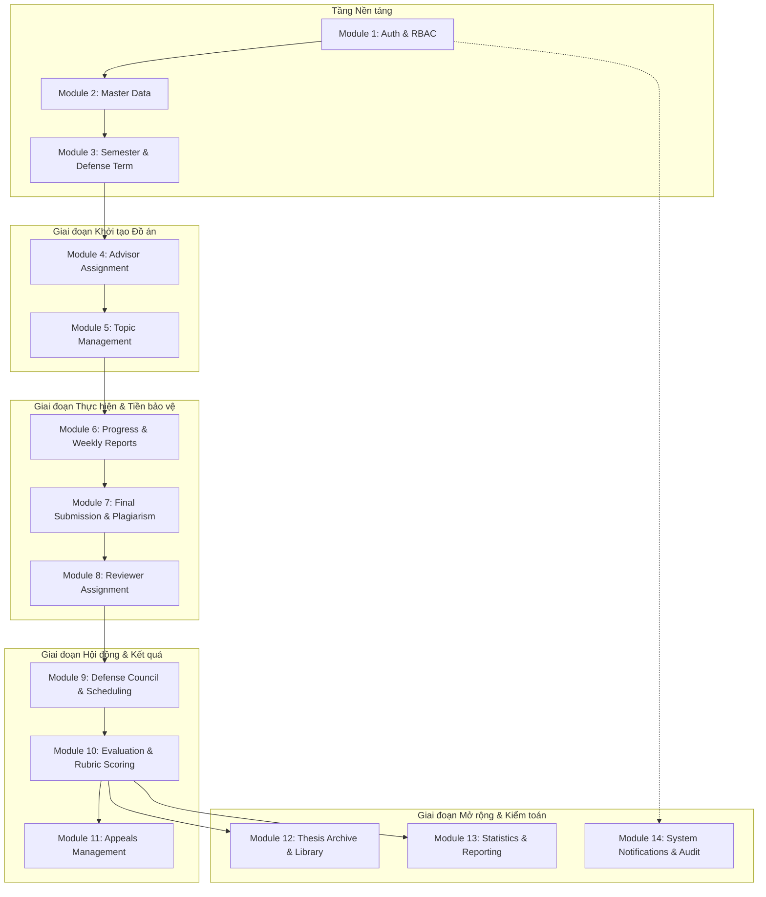

# 🗺️ LỘ TRÌNH TRIỂN KHAI DỰ ÁN HỆ THỐNG QUẢN LÝ ĐỒ ÁN TỐT NGHIỆP UTC2 (UTC2-DAMS)

> **Dự án:** Hệ thống Quản lý Đồ án Tốt nghiệp – Phân hiệu Trường Đại học GTVT tại TP.HCM  
> **Chiến lược Triển khai:** **BACKEND-FIRST** (Xây dựng, hoàn thiện và kiểm thử toàn bộ 14 Modules Backend trước $\rightarrow$ Phát triển Frontend Next.js sau $\rightarrow$ Tích hợp E2E & Triển khai).  
> **Kiến trúc:** Monorepo (Next.js 15 App Router + NestJS 11 + PostgreSQL 16 + Prisma 7 Multi-file ORM + Redis + MinIO + Docker)  
> **Quy mô:** 14 Modules Backend, 87 RESTful Endpoints, 28 Bảng CSDL, 4 Role kỹ thuật (`ADMIN`, `STUDENT`, `LECTURER`, `STAFF`), 45 Permissions, 13 Business Rules (BR-01 $\rightarrow$ BR-13).

---

## 📑 MỤC LỤC
1. [Tổng quan Chiến lược & Các Cột mốc (Milestones)](#1-tổng-quan-chiến-lược--các-cột-mốc-milestones)
2. [Sơ đồ Phụ thuộc Module & Luồng dữ liệu Backend](#2-sơ-đồ-phụ-thuộc-module--luồng-dữ-liệu-backend)
3. [Chi tiết Kế hoạch Triển khai (Giai đoạn Backend-First $\rightarrow$ Frontend $\rightarrow$ E2E)](#3-chi-tiết-kế-hoạch-triển-khai)
   - [PHẦN 1: TOÀN DIỆN BACKEND (Sprint 1 $\rightarrow$ Sprint 7)](#phần-1-toàn-diện-backend-sprint-1--sprint-7)
     - [Sprint 1: Database Seeding & Module 1 (Auth & Dynamic RBAC)](#sprint-1-database-seeding--module-1-auth--dynamic-rbac)
     - [Sprint 2: Module 2 (Master Data) & Module 3 (Semesters, Defense Terms & Rubrics)](#sprint-2-module-2-master-data--module-3-semesters-defense-terms--rubrics)
     - [Sprint 3: Module 4 (Advisor Allocation) & Module 5 (Topic Management)](#sprint-3-module-4-advisor-allocation--module-5-topic-management)
     - [Sprint 4: Module 6 (Progress & Weekly Reports) & Module 7 (Final Submission & Plagiarism)](#sprint-4-module-6-progress--weekly-reports--module-7-final-submission--plagiarism)
     - [Sprint 5: Module 8 (Reviewer), Module 9 (Councils) & Module 10 (Evaluation & Rubrics)](#sprint-5-module-8-reviewer-module-9-councils--module-10-evaluation--rubrics)
     - [Sprint 6: Module 11 (Appeals), Module 12 (Archive), Module 13 (Statistics) & Module 14 (Audit)](#sprint-6-module-11-appeals-module-12-archive-module-13-statistics--module-14-audit)
     - [Sprint 7: Backend Unit/Integration Testing, Load Test & Security Audit](#sprint-7-backend-unitintegration-testing-load-test--security-audit)
   - [PHẦN 2: TOÀN DIỆN FRONTEND NEXT.JS (Sprint 8 $\rightarrow$ Sprint 9)](#phần-2-toàn-diện-frontend-nextjs-sprint-8--sprint-9)
     - [Sprint 8: Next.js Auth, Master Layouts, Student & Lecturer Spaces](#sprint-8-nextjs-auth-master-layouts-student--lecturer-spaces)
     - [Sprint 9: Department, Academic Affairs, Dean & Admin Portals](#sprint-9-department-academic-affairs-dean--admin-portals)
   - [PHẦN 3: TÍCH HỢP E2E & DEPLOYMENT (Sprint 10)](#phần-3-tích-hợp-e2e--deployment-sprint-10)
     - [Sprint 10: E2E Integration Testing, Docker Multi-stage & Production Release](#sprint-10-e2e-integration-testing-docker-multi-stage--production-release)
4. [Ma trận Kiểm tra Ràng buộc Nghiệp vụ (Business Rules Checklist)](#4-ma-trận-kiểm-tra-ràng-buộc-nghiệp-vụ-business-rules-checklist)
5. [Tiêu chuẩn Hoàn thành (Definition of Done - DoD)](#5-tiêu-chuẩn-hoàn-thành-definition-of-done---dod)
6. [Quản trị Rủi ro & Giải pháp (Risk Management)](#6-quản-trị-rủi-ro--giải-pháp-risk-management)

---

## 1. Tổng quan Chiến lược & Các Cột mốc (Milestones)

Hệ thống áp dụng phương pháp **Backend-First**: Toàn bộ nghiệp vụ, CSDL, phân quyền, API và tài liệu Scalar/Swagger được hoàn thiện và kiểm thử độc lập trước khi xây dựng giao diện người dùng.

```mermaid
timeline
    title Lộ trình Triển khai UTC2-DAMS (Chiến lược Backend-First)
    section Giai đoạn I: Backend Core & APIs
      Sprint 1 : DB Seeding : Module 1 Auth & RBAC
      Sprint 2 : Module 2 Master Data : Module 3 Semesters & Rubrics
      Sprint 3 : Module 4 Advisor Allocation : Module 5 Topics Management
      Sprint 4 : Module 6 Progress Reports : Module 7 Final Submissions
      Sprint 5 : Module 8 Reviewers : Module 9 Councils : Module 10 Evaluation
      Sprint 6 : Module 11 Appeals : Module 12 Archive : Module 13 Stats : Module 14 Audit
      Sprint 7 : Backend Testing (Unit/Integration) : Security Audit
    section Giai đoạn II: Frontend Next.js
      Sprint 8 : Auth Flow : Student & Lecturer Portals
      Sprint 9 : Department, Staff, Dean & Admin Spaces
    section Giai đoạn III: Release
      Sprint 10 : E2E Testing : Docker Production Deploy
```

| Cột mốc (Milestone) | Phạm vi Sprint | Mục tiêu đầu ra chính | Trạng thái |
| :--- | :---: | :--- | :---: |
| **M1: Backend Foundation & Auth** | Sprint 1 | Seed 4 Roles, 45 Perms; Token Rotation (15m/7d); 3 Guards bảo vệ | ⏳ Sắp bắt đầu |
| **M2: Master Data & Terms** | Sprint 2 | API CRUD Khoa/Bộ môn/Lớp/SV/GV; Quản lý Học kỳ & Đợt đồ án; Mẫu Rubrics | 📋 Kế hoạch |
| **M3: Matching & Topics Engine** | Sprint 3 | Quota GVHD (BR-03); Đăng ký nguyện vọng (BR-02); Đề tài & Thẩm định 2 cấp (BR-05) | 📋 Kế hoạch |
| **M4: Tracking & Pre-defense** | Sprint 4 | Nộp báo cáo tuần; MinIO đính kèm; Báo cáo toàn văn; Check đạo văn $\le 25\%$ (BR-06) | 📋 Kế hoạch |
| **M5: Defense & Final Scoring** | Sprint 5 | Phân công GVPB (BR-07); Hội đồng $\ge 3$ thành viên (BR-09, 10); Chấm điểm 30-20-50 (BR-08) | 📋 Kế hoạch |
| **M6: Closure & Analytics** | Sprint 6 | Phúc khảo (BR-12); Khóa điểm HK (BR-13); Lưu trữ đồ án; Thống kê & Xuất Excel/PDF | 📋 Kế hoạch |
| **M7: Backend Hardening** | Sprint 7 | Unit & Integration Test Coverage $\ge 80\%$; Load Testing; Rà soát OWASP | 📋 Kế hoạch |
| **M8: Frontend Portals** | Sprint 8 - 9 | Next.js 15 UI/UX cho toàn bộ 4 Role kỹ thuật & 6 phân hệ người dùng | 📋 Kế hoạch |
| **M9: Production Release** | Sprint 10 | E2E Playwright/Cypress; Docker Compose Multi-stage; Nginx Reverse Proxy; Bàn giao | 📋 Kế hoạch |

---

## 2. Sơ đồ Phụ thuộc Module & Luồng dữ liệu Backend



---

## 3. Chi tiết Kế hoạch Triển khai

### PHẦN 1: TOÀN DIỆN BACKEND (Sprint 1 $\rightarrow$ Sprint 7)

#### Sprint 1: Database Seeding & Module 1 (Auth & Dynamic RBAC)
- **Mục tiêu:** Hoàn thiện hạ tầng bảo mật dữ liệu, seed đầy đủ danh mục phân quyền và kiểm thử authentication.
- **Chi tiết Tasks Backend:**
  - [ ] **Database Seeding (`apps/backend/prisma/seed.ts`):**
    - Seed 4 Roles kỹ thuật: `ADMIN`, `STUDENT`, `LECTURER`, `STAFF`.
    - Seed 45 Permissions theo chuẩn `module:action`.
    - Tạo tài khoản Super Admin khởi tạo (`admin` / `Admin@123456`, password băm `bcryptjs` salt 10).
    - Seed dữ liệu cơ cấu: 1 Khoa (CNTT), 2 Ngành (CNPM, HTTT), 2 Bộ môn, 1 Học kỳ mở đầu.
  - [ ] **Xây dựng Module 1 (Authentication & RBAC):**
    - `POST /api/v1/auth/login`: Xác thực credentials, cấp Access Token (15m) + Refresh Token (7d).
    - `POST /api/v1/auth/refresh`: Cấp mới token xoay vòng (Token Rotation) chống replay attack.
    - `POST /api/v1/auth/logout`: Đưa Refresh Token vào blacklist / xóa session.
    - `GET /api/v1/auth/me`: Trả về thông tin cá nhân kèm mảng roles, scopes và permissions.
    - `POST /api/v1/auth/change-password`: Đổi mật khẩu tài khoản người dùng.
    - `POST /api/v1/auth/forgot-password` & `POST /api/v1/auth/reset-password`: Quy trình khôi phục mật khẩu qua OTP/Email.
  - [ ] **Hoàn thiện Bộ 3 Guards & Custom Decorators:**
    - `JwtAuthGuard` (xác thực token).
    - `RolesGuard` (kiểm tra `@Roles(...)`).
    - `PermissionsGuard` (kiểm tra `@RequirePermissions(...)`).
    - `@CurrentUser()`: Trích xuất context người dùng từ request.

---

#### Sprint 2: Module 2 (Master Data) & Module 3 (Semesters, Defense Terms & Rubrics)
- **Mục tiêu:** Cung cấp toàn bộ API danh mục tổ chức trường/khoa/ngành/lớp, mở học kỳ, cấu hình đợt đồ án và ma trận tiêu chí chấm điểm.
- **Chi tiết Tasks Backend:**
  - [ ] **Xây dựng Module 2 (Master Data & Academic Structures - 10 endpoints):**
    - CRUD Khoa (`faculties`), Bộ môn (`departments`), Ngành học (`majors`), Lớp sinh hoạt (`classes`).
    - CRUD Giảng viên (`lecturers`) & Sinh viên (`students`).
    - API Bulk Import danh sách sinh viên / giảng viên từ file Excel.
  - [ ] **Xây dựng Module 3 (Semester & Defense Term Management - 8 endpoints):**
    - CRUD Học kỳ (`semesters`), kích hoạt học kỳ hiện tại (`is_active = true`).
    - CRUD Đợt đồ án (`defense_terms`): thiết lập mốc thời gian (timeline 7 giai đoạn: mở đăng ký, duyệt đề tài, nộp báo cáo, phản biện, bảo vệ).
    - CRUD Mẫu tiêu chí đánh giá (`rubric_sets`, `evaluation_criteria`) cho GVHD (30%), GVPB (20%), Hội đồng (50%) (BR-08).

---

#### Sprint 3: Module 4 (Advisor Allocation) & Module 5 (Topic Management)
- **Mục tiêu:** Xây dựng quy trình ghép cặp hướng dẫn và ngân hàng đề tài qua 2 cấp thẩm định.
- **Chi tiết Tasks Backend:**
  - [ ] **Xây dựng Module 4 (Advisor Registration & Allocation - 6 endpoints):**
    - Khởi tạo và cập nhật Quota tiếp nhận sinh viên theo học hàm/học vị của Giảng viên (GS/PGS $\le 7$, TS $\le 5$, ThS $\le 3$, BR-03).
    - Sinh viên nộp đơn đăng ký nguyện vọng GVHD (`advisor_requests`) trong khung giờ mở đợt (BR-02).
    - Giảng viên duyệt/từ chối sinh viên theo Quota.
    - Bộ môn/Giáo vụ phân công tự động hoặc ghép cặp thủ công cho sinh viên chưa có GVHD.
  - [ ] **Xây dựng Module 5 (Topic Proposal & Approval - 9 endpoints):**
    - CRUD Đề tài tốt nghiệp (`topics`): Tên tiếng Việt, Tiếng Anh, Mục tiêu, Yêu cầu, Phạm vi, Sản phẩm dự kiến.
    - Ràng buộc: Mỗi sinh viên tối đa 1 đề tài trong cùng 1 đợt (BR-01), tối đa 2 sinh viên/đề tài (BR-04).
    - Quy trình thẩm định đề tài 2 cấp (BR-05):
      - Cấp 1: Trưởng bộ môn đánh giá (`APPROVED_BY_HOD` / `REJECTED`).
      - Cấp 2: Ban chủ nhiệm Khoa phê duyệt cuối cùng (`APPROVED_BY_DEAN`).
    - API Phân công đề tài cho nhóm sinh viên (`registrations`).

---

#### Sprint 4: Module 6 (Progress & Weekly Reports) & Module 7 (Final Submission & Plagiarism)
- **Mục tiêu:** Theo dõi tiến độ định kỳ hàng tuần, quản lý nộp báo cáo toàn văn và thẩm định tỷ lệ đạo văn.
- **Chi tiết Tasks Backend:**
  - [ ] **Xây dựng Module 6 (Progress Tracking & Weekly Reports - 5 endpoints):**
    - Quản lý Mốc tiến độ (`milestones`) của đợt đồ án.
    - Sinh viên nộp Báo cáo tuần (`progress_reports`) kèm tài liệu tải lên MinIO.
    - Giảng viên nhận xét, chấm điểm tiến độ và ghi nhận Nhật ký trao đổi (`mentoring_logs`).
  - [ ] **Xây dựng Module 7 (Final Submission & Plagiarism Verification - 5 endpoints):**
    - Sinh viên nộp bản toàn văn (báo cáo PDF, slide thuyết trình, source code repo, demo link) vào `thesis_submissions`.
    - GVHD đánh giá bản cuối và xác nhận đồng ý/từ chối cho phép ra bảo vệ (`is_approved_for_defense`).
    - Tích hợp kiểm tra và cập nhật tỷ lệ trùng lặp đạo văn (`similarity_percentage` $\le 25\%$ theo BR-06).

---

#### Sprint 5: Module 8 (Reviewer), Module 9 (Councils) & Module 10 (Evaluation & Rubrics)
- **Mục tiêu:** Phân công phản biện, thành lập hội đồng bảo vệ, lập lịch phòng/ca thi và chấm điểm hội đồng trực tiếp theo Rubrics.
- **Chi tiết Tasks Backend:**
  - [ ] **Xây dựng Module 8 (Reviewer Assignment & Pre-defense Review - 4 endpoints):**
    - Trưởng bộ môn phân công Cán bộ Phản biện (GVPB).
    - Ràng buộc: GVPB không được trùng với GVHD (BR-07).
    - GVPB nộp Phiếu nhận xét phản biện và chấm điểm sơ bộ.
    - Xét duyệt danh sách sinh viên đủ điều kiện ra Hội đồng.
  - [ ] **Xây dựng Module 9 (Defense Council & Scheduling - 8 endpoints):**
    - Thành lập Hội đồng bảo vệ (`councils`) với tối thiểu 3 thành viên: Chủ tịch, Thư ký, Ủy viên (BR-09).
    - Ràng buộc: GVHD không được làm Chủ tịch/GVPB trong hội đồng chấm đề tài của mình (BR-10).
    - Lập lịch bảo vệ (`defense_schedules`): gán đề tài, phòng thi, ca chấm; kiểm tra chống xung đột phòng và thành viên.
  - [ ] **Xây dựng Module 10 (Evaluation & Rubric Scoring - 8 endpoints):**
    - Từng thành viên Hội đồng nhập điểm chi tiết theo tiêu chí Rubric (`detailed_scores`).
    - Tự động tính điểm tổng kết theo trọng số: **GVHD 30% - GVPB 20% - Hội đồng 50%** (BR-08).
    - Quy đổi điểm thang 10 sang thang chữ (A, B, C, D, F) và xác định Đạt/Không đạt ($\ge 4.0$, BR-11).

---

#### Sprint 6: Module 11 (Appeals), Module 12 (Archive), Module 13 (Statistics) & Module 14 (Audit)
- **Mục tiêu:** Xử lý phúc khảo điểm, khóa điểm học kỳ, lưu trữ kho đồ án, xuất báo cáo thống kê Excel/PDF và ghi vết kiểm toán.
- **Chi tiết Tasks Backend:**
  - [ ] **Xây dựng Module 11 (Appeals Management - 5 endpoints):**
    - Sinh viên nộp Đơn phúc khảo (`grade_appeals`) trong vòng 7 ngày kể từ khi công bố điểm (BR-12).
    - Hội đồng phúc khảo thẩm tra, cập nhật điểm sau phúc khảo và ghi rõ lý do.
  - [ ] **Xây dựng Module 12 (Thesis Archive & Library - 5 endpoints):**
    - Khóa bảng điểm học kỳ (`is_locked`), chuyển dữ liệu sang kho lưu trữ số (`thesis_archives`) (BR-13).
    - Tra cứu toàn văn đồ án tốt nghiệp lưu trữ theo từ khóa, ngành, năm học, GVHD.
  - [ ] **Xây dựng Module 13 (Statistics & Reporting - 6 endpoints):**
    - Thống kê tỷ lệ đề tài, phân phối điểm, tỷ lệ đạt/trượt theo Khoa/Ngành/Học kỳ.
    - Xuất file Excel Bảng điểm tổng kết, Danh sách đề tài, Danh sách phân công.
    - Xuất file PDF Quyết định giao đề tài, Phiếu chấm điểm, Biên bản chấm hội đồng UTC2.
  - [ ] **Xây dựng Module 14 (System Notifications & Audit Logs - 8 endpoints):**
    - Gửi thông báo hệ thống và email tự động (BullMQ + Redis).
    - `AuditLogInterceptor`: Tự động ghi lại lịch sử thao tác nhạy cảm (Sửa điểm, Duyệt đề tài, Phân công) kèm IP và Account ID.

---

#### Sprint 7: Backend Unit/Integration Testing, Load Test & Security Audit
- **Mục tiêu:** Kiểm thử toàn diện chất lượng Backend, tối ưu hóa CSDL và rà soát an ninh trước khi chuyển sang làm Frontend.
- **Tasks Chi tiết:**
  - [ ] Viết Unit Test cho toàn bộ 14 Services nghiệp vụ (Jest, mock Prisma & Redis) $\rightarrow$ Đạt coverage $\ge 80\%$.
  - [ ] Viết Integration Test cho 7 quy trình nghiệp vụ cốt lõi (End-to-End API Flow).
  - [ ] Rà soát an ninh OWASP Top 10: SQL Injection, XSS, CSRF, Rate Limiting (`@nestjs/throttler`), Privilege Escalation.
  - [ ] Tối ưu hóa Database: Rà soát Indexing 28 bảng PostgreSQL, xử lý triệt để bài toán N+1 query trong Prisma.
  - [ ] Kiểm tra đồng bộ hoàn chỉnh trên **Scalar API Reference** (`/api/reference`) và **Swagger UI** (`/api/docs`).

---

### PHẦN 2: TOÀN DIỆN FRONTEND NEXT.JS (Sprint 8 $\rightarrow$ Sprint 9)

#### Sprint 8: Next.js Auth, Master Layouts, Student & Lecturer Spaces
- **Mục tiêu:** Xây dựng khung ứng dụng Next.js 15, tích hợp Auth Token, và hoàn thiện 2 phân hệ Sinh viên & Giảng viên.
- **Tasks Chi tiết:**
  - [ ] Tích hợp Next.js App Router, Tailwind CSS, Shadcn/UI, React Hook Form, Zod, React Query & Zustand.
  - [ ] Xây dựng Auth Flow: Trang Login, Quên mật khẩu, Lưu Refresh Token trong HttpOnly Cookie, Auto-refresh token qua Axios interceptor.
  - [ ] **Student Space (`/student/*`):** Tra cứu GVHD/Đề tài, Nộp nguyện vọng, Nộp báo cáo tuần, Nộp bản toàn văn, Xem lịch bảo vệ, Tra cứu điểm & Nộp đơn phúc khảo.
  - [ ] **Lecturer Space (`/lecturer/*`):** Thiết lập Quota, Duyệt sinh viên, Đề xuất đề tài, Nhận xét báo cáo tuần, Đánh giá tiền bảo vệ, Nhận xét phản biện, Nhập điểm Hội đồng theo Rubric.

---

#### Sprint 9: Department, Academic Affairs, Dean & Admin Portals
- **Mục tiêu:** Hoàn thiện 4 phân hệ quản trị còn lại trên giao diện Frontend.
- **Tasks Chi tiết:**
  - [ ] **Department Space (`/department/*`):** Phân công GVHD, Thẩm định đề tài (Cấp 1), Phân công GVPB, Đề xuất nhân sự Hội đồng.
  - [ ] **Academic Affairs Space (`/academic-affairs/*`):** Quản lý Học kỳ & Đợt đồ án, Quản lý Khoa/Bộ môn/Lớp, Lập lịch bảo vệ phòng/ca thi, Khóa bảng điểm học kỳ.
  - [ ] **Dean Space (`/dean/*`):** Phê duyệt đề tài toàn khoa (Cấp 2), Ký duyệt danh sách Hội đồng, Phê duyệt kết quả phúc khảo.
  - [ ] **Admin Portal (`/admin/*`):** Quản trị Tài khoản & Phân quyền động (Dynamic RBAC), Xem Audit Logs, Cấu hình tham số hệ thống.
  - [ ] Tích hợp Dashboard thống kê trực quan (Recharts / Chart.js) & Công cụ Xuất Excel/PDF 1-click.

---

### PHẦN 3: TÍCH HỢP E2E & DEPLOYMENT (Sprint 10)

#### Sprint 10: E2E Integration Testing, Docker Multi-stage & Production Release
- **Mục tiêu:** Kiểm thử liên thông trọn vẹn toàn bộ hệ thống từ Frontend tới Backend và đóng gói phát hành Production.
- **Tasks Chi tiết:**
  - [ ] Viết E2E Test tự động mô phỏng toàn bộ hành trình tốt nghiệp (Sinh viên đăng ký $\rightarrow$ GV duyệt $\rightarrow$ Nộp bài $\rightarrow$ Chấm hội đồng $\rightarrow$ Khóa sổ).
  - [ ] Đóng gói Production Docker Compose:
    - Dockerfile Multi-stage build cho Next.js 15 (Stand-alone output).
    - Dockerfile Multi-stage build cho NestJS 11.
    - Cấu hình Nginx Reverse Proxy, nén Gzip/Brotli & SSL Certbot HTTPS.
  - [ ] Thiết lập CI/CD Pipeline (GitHub Actions): Type check, Lint, Test, Docker Build & Push.
  - [ ] Bàn giao toàn bộ tài liệu vận hành và hướng dẫn triển khai.

---

## 4. Ma trận Kiểm tra Ràng buộc Nghiệp vụ (Business Rules Checklist)

| Mã BR | Quy tắc Nghiệp vụ (SRS) | Module Backend phụ trách | Vị trí Thực thi (Enforcement) | Sprint Hoàn thành |
| :---: | :--- | :---: | :---: | :---: |
| **BR-01** | Sinh viên chỉ được làm tối đa **1 đề tài** trong cùng 1 học kỳ/đợt đồ án. | Module 4 & 5 | `UniqueConstraint` DB + Service Validation | Sprint 3 |
| **BR-02** | Sinh viên chỉ được đăng ký/sửa nguyện vọng trong khung thời gian đợt mở. | Module 4 | `AdvisorService` (Check `DefenseTerm.timeline`) | Sprint 3 |
| **BR-03** | Giảng viên không được nhận vượt quá **Quota tối đa** (GS/PGS $\le 7$, TS $\le 5$, ThS $\le 3$). | Module 4 | `AdvisorService.assignAdvisor()` | Sprint 3 |
| **BR-04** | Mỗi đề tài có tối đa **2 sinh viên** thực hiện (nếu làm theo nhóm). | Module 5 | `TopicService.createTopic()` & DB Check | Sprint 3 |
| **BR-05** | Đề tài phải qua **2 cấp thẩm định** (Bộ môn duyệt $\rightarrow$ Khoa phê duyệt). | Module 5 | `TopicService.approveByHod()` & `approveByDean()` | Sprint 3 |
| **BR-06** | Tỷ lệ trùng lặp đạo văn bản toàn văn phải **$\le 25\%$** mới được xét bảo vệ. | Module 7 | `ThesisSubmissionService.verifyPlagiarism()` | Sprint 4 |
| **BR-07** | Cán bộ phản biện (GVPB) **không được trùng** với Cán bộ hướng dẫn (GVHD). | Module 8 | `ReviewerService.assignReviewer()` | Sprint 5 |
| **BR-08** | Cấu trúc trọng số điểm bắt buộc: **GVHD 30% - GVPB 20% - Hội đồng 50%**. | Module 10 | `EvaluationService.calculateFinalScore()` | Sprint 5 |
| **BR-09** | Hội đồng bảo vệ đồ án phải có tối thiểu **3 thành viên** (Chủ tịch, Thư ký, Ủy viên). | Module 9 | `CouncilService.createCouncil()` | Sprint 5 |
| **BR-10** | GVHD **không được làm Chủ tịch hoặc GVPB** trong hội đồng chấm đề tài của mình. | Module 9 | `CouncilService.assignTopicToCouncil()` | Sprint 5 |
| **BR-11** | Sinh viên phải có điểm tổng kết **$\ge 4.0/10$** mới được công nhận đạt đồ án. | Module 10 | `EvaluationService.determinePassFail()` | Sprint 5 |
| **BR-12** | Đơn phúc khảo chỉ được nộp trong vòng **7 ngày** kể từ ngày công bố điểm. | Module 11 | `AppealsService.submitAppeal()` | Sprint 6 |
| **BR-13** | Sau khi **Khóa điểm học kỳ**, không ai được phép sửa đổi điểm trừ quy trình phúc khảo. | Module 10 & 11 | `EvaluationGuard` & `AuditInterceptor` | Sprint 6 |

---

## 5. Tiêu chuẩn Hoàn thành (Definition of Done - DoD)

Mỗi tính năng/module chỉ được coi là hoàn thành khi đáp ứng trọn vẹn 6 tiêu chí kỹ thuật:
1. **Mã nguồn Chuẩn mực:** Tuân thủ kiến trúc phân tầng (Controller $\rightarrow$ Service $\rightarrow$ Repository), áp dụng nguyên tắc Single Responsibility (SRP).
2. **Kiểm tra Dữ liệu Chặt chẽ:** DTO đầy đủ decorators `class-validator`, mọi biến môi trường được đọc bằng `getOrThrow()`.
3. **Phân quyền 3 Lớp:** Đặt đầy đủ `@UseGuards(JwtAuthGuard, RolesGuard, PermissionsGuard)` và `@RequirePermissions()`.
4. **Tài liệu API Tự động:** Khai báo đầy đủ `@ApiTags()`, `@ApiOperation()`, `@ApiResponse()` hiển thị chuẩn trên **Scalar UI** (`/api/reference`) & **Swagger** (`/api/docs`).
5. **Giao diện Trực quan (ở Giai đoạn Frontend):** Frontend Next.js xử lý đầy đủ các trạng thái `Loading`, `Success`, `Empty`, `Error Alert`, tương thích Responsive.
6. **Kiểm tra Build & Type Check:** Lệnh `npx tsc --noEmit` và `npm run build` trên cả Backend và Frontend chạy thành công **0 lỗi**.

---

## 6. Quản trị Rủi ro & Giải pháp (Risk Management)

| Rủi ro Kỹ thuật / Nghiệp vụ | Mức độ | Biện pháp Phòng ngừa & Xử lý |
| :--- | :---: | :--- |
| **Xung đột lịch bảo vệ (Trùng phòng, trùng ca của GV)** | Cao | Sử dụng giao dịch cơ sở dữ liệu (Database Transaction + Serializable Lock) và thuật toán quét chồng chéo thời gian trước khi lưu lịch. |
| **Nghẽn tải khi hàng loạt sinh viên nộp báo cáo tuần/cuối kỳ** | Trung bình | Tải file trực tiếp lên MinIO/S3 thông qua Presigned Upload URL; xử lý nén/quét file ngầm qua BullMQ worker. |
| **Gian lận sửa đổi điểm số sau khi chấm** | Rất cao | Áp dụng khóa điểm cứng (State Machine `LOCKED`), lưu vết toàn bộ thay đổi vào bảng `audit_logs` kèm IP và User ID thực hiện. |
| **Thay đổi cấu trúc Schema Prisma khi phát triển** | Trung bình | Sử dụng Prisma Multi-file schema độc lập theo domain, chạy `npx prisma migrate dev` kèm tên migration có ý nghĩa rõ ràng. |
