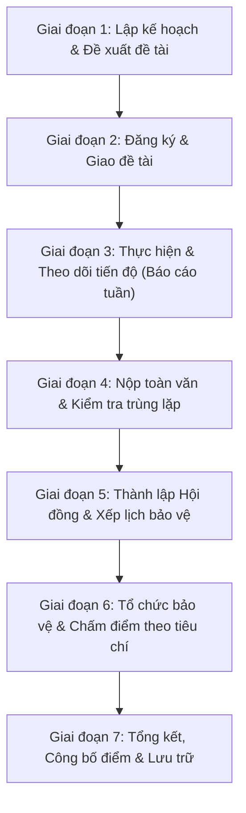

# TÀI LIỆU TÓM TẮT ĐẶC TẢ YÊU CẦU PHẦN MỀM (SRS)
## HỆ THỐNG WEB QUẢN LÝ ĐỒ ÁN CƠ SỞ & ĐỒ ÁN CHUYÊN NGÀNH (UTC2 - DAMS)

> **Thông tin đề tài:**
> - **Cơ sở:** Trường Đại học Giao thông Vận tải – Phân hiệu tại TP. Hồ Chí Minh (UTC2).
> - **Giảng viên hướng dẫn:** ThS. Phạm Thị Miên
> - **Sinh viên thực hiện:** Dư Nguyên An – MSSV: 6551071001 (Lớp: CQ.65.CNTT)
> - **Phiên bản tài liệu:** 1.0 (Bản chuẩn hóa theo SRS IEEE 830-1998)
> - **Stack công nghệ mục tiêu:** Frontend: **Next.js** | Backend: **NestJS (TypeScript)** | Database: **PostgreSQL**

---

## 1. MỤC TIÊU VÀ PHẠM VI HỆ THỐNG

### 1.1. Mục tiêu giải quyết bất cập
| Bất cập hiện tại | Giải pháp của hệ thống UTC2-DAMS |
| :--- | :--- |
| Dữ liệu phân tán (Excel, email, giấy tờ), khó tra cứu khóa cũ | CSDL tập trung trên PostgreSQL, dễ dàng truy vết và tái sử dụng |
| Thiếu thống nhất giữa các khoa về biểu mẫu, thời hạn, cách chấm | Chuẩn hóa quy trình chung 7 giai đoạn, cho phép cấu hình linh hoạt theo từng Khoa |
| Khó kiểm soát tiến độ tuần; phát hiện chậm trễ muộn | Báo cáo tuần trực tuyến, dashboard thời gian thực, nhắc nhở & cảnh báo tự động |
| Khó kiểm soát đạo văn / trùng lặp đề tài giữa các khóa | Cơ chế đối chiếu văn bản tự động với kho đồ án đã lưu trữ |
| Đăng ký, xếp lịch HĐ, tính điểm thủ công dễ sai lệch | Tự động kiểm tra điều kiện, check trùng lịch HĐ, tính điểm có trọng số tự động |

### 1.2. Phạm vi 5 Phân hệ chính & Module nền tảng
1. **Phân hệ 1.0 – Quản lý đề tài (DT):** Giảng viên đề xuất đề tài $\rightarrow$ Trưởng bộ môn (TBM) duyệt $\rightarrow$ Ban Chủ nhiệm (BCN) phê duyệt $\rightarrow$ Công bố danh sách đề tài.
2. **Phân hệ 2.0 – Quản lý đăng ký (DK):** Sinh viên tra cứu $\rightarrow$ Đăng ký đề tài theo chỉ tiêu $\rightarrow$ Hệ thống kiểm tra điều kiện (tín chỉ, GPA, không nợ đồ án) $\rightarrow$ Chốt danh sách.
3. **Phân hệ 3.0 – Quản lý tiến độ (TD):** Sinh viên nộp báo cáo tuần $\rightarrow$ GVHD nhận xét, chấm mức độ hoàn thành $\rightarrow$ Hệ thống cảnh báo tự động khi nợ báo cáo.
4. **Phân hệ 4.0 – Quản lý Hội đồng & Lịch bảo vệ (HD):** Giáo vụ tạo Hội đồng $\rightarrow$ TBM đề xuất thành viên $\rightarrow$ BCN phân công (Chủ tịch, Thư ký, Ủy viên $\ge 3$) $\rightarrow$ Gán SV, xếp ca, **tự động kiểm tra xung đột phòng/giảng viên**.
5. **Phân hệ 5.0 – Quản lý chấm điểm & Báo cáo (BC & CD):** Nộp báo cáo toàn văn $\rightarrow$ Kiểm tra trùng lặp $\rightarrow$ GVHD xác nhận đủ điều kiện bảo vệ $\rightarrow$ Chấm điểm theo bộ tiêu chí trọng số $\rightarrow$ Khóa phiếu điểm $\rightarrow$ Tính điểm tổng kết $\rightarrow$ Công bố & Xử lý khiếu nại.
6. **Các Module nền tảng:** Xác thực & Phân quyền (AUT), Quản lý Danh mục (DM), Thông báo & Email (TB), Nhật ký hệ thống (Audit Log), Báo cáo thống kê (TK).

---

## 2. MA TRẬN TÁC NHÂN & MÔ HÌNH PHÂN QUYỀN

Hệ thống quy định **8 Tác nhân nghiệp vụ**, khi ánh xạ vào hệ thống kỹ thuật sẽ gom thành **4 Role cơ sở** kết hợp với **Bảng chức danh gán (Scope Role)**:

```
┌────────────────────────────────────────────────────────────────────────┐
│                        TÀI KHOẢN HỆ THỐNG                              │
├─────────────────┬──────────────────────┬───────────────────────────────┤
│ Role Kỹ Thuật   │ Chức Danh Nghiệp Vụ  │ Phạm Vi Áp Dụng (Scope)       │
├─────────────────┼──────────────────────┼───────────────────────────────┤
│ Sinh viên       │ Sinh viên            │ Cá nhân                       │
│ Giảng viên      │ Giảng viên (GVHD)    │ Theo đề tài hướng dẫn         │
│                 │ Thành viên Hội đồng  │ Theo Hội đồng được phân công  │
│                 │ Trưởng bộ môn (TBM)  │ Theo Bộ môn quản lý           │
│                 │ Ban Chủ nhiệm Khoa   │ Theo Khoa quản lý             │
│ Nhân viên QL    │ Giáo vụ Khoa (GVK)   │ Theo Khoa quản lý             │
│                 │ Phòng Đào tạo        │ Toàn trường                   │
│                 │ Ban Giám đốc         │ Toàn trường (Chỉ đọc)         │
│ Quản trị        │ Admin                │ Toàn hệ thống (Kỹ thuật)      │
└─────────────────┴──────────────────────┴───────────────────────────────┘
```

### Ma trận quyền thao tác chính
*Ký hiệu: **T** = Tạo, **S** = Sửa/Xóa, **X** = Xem, **D** = Duyệt/Phê duyệt, **N** = Nhập/Nộp, **Q** = Quản trị, **–** = Không có quyền.*

| Nghiệp vụ / Thực thể | Sinh viên | GVHD | Thành viên HĐ | Trưởng Bộ môn | Giáo vụ Khoa | BCN Khoa | Phòng Đào tạo | Quản trị viên |
| :--- | :---: | :---: | :---: | :---: | :---: | :---: | :---: | :---: |
| **Đề tài** | X | T, S (của mình) | X | D (Bộ môn) | X | D (Khoa) | X | Q |
| **Đăng ký đề tài** | T, S (trong hạn) | D (xác nhận) | X | X (Bộ môn) | S, D (chốt) | D (ngoại lệ) | X | – |
| **Báo cáo tuần** | N, S (trong hạn) | N (nhận xét) | – | X (Bộ môn) | X (Khoa) | X (Khoa) | – | – |
| **Báo cáo toàn văn** | N (trong hạn) | D (duyệt BV) | X (HĐ mình) | X (Bộ môn) | X, D (duyệt DS) | D (xử lý trùng) | – | – |
| **Lập Hội đồng & Lịch** | X (lịch mình) | X | X | T (đề xuất) | T, S, D | D (phê duyệt) | X | – |
| **Chấm điểm chi tiết** | – | N (điểm GVHD) | N (phiếu HĐ) | X | X | D (mở khóa) | X | – |
| **Tổng kết & Công bố** | X | X | X | X | T, S, D (công bố) | D (duyệt) | X | – |
| **Khiếu nại điểm** | T | – | – | – | X | D (giải quyết) | X | – |
| **Danh mục & Cấu hình**| – | – | – | – | S (cấu hình khoa)| – | T, S (nền tảng)| Q (hệ thống) |
| **Tài khoản & Phân quyền**| – | – | – | – | – | – | – | T, S, Q |

---

## 3. QUY TRÌNH 7 GIAI ĐOẠN & STATE MACHINE



### Vòng đời trạng thái của các thực thể cốt lõi
1. **Đề tài (`de_tai`):**
   `Mới tạo` $\rightarrow$ `Chờ duyệt` (gửi TBM) $\rightarrow$ `Đã duyệt` (hoặc `Từ chối`) $\rightarrow$ `Đã giao` (đủ SV đăng ký) $\rightarrow$ `Hủy / Lưu trữ`.
2. **Đăng ký (`dang_ky`):**
   `Đã đăng ký` $\rightarrow$ `Đã chốt` (GVK/BCN duyệt) $\rightarrow$ `Đang thực hiện` $\rightarrow$ `Chờ thẩm định` (nộp toàn văn) $\rightarrow$ `Đủ điều kiện BV` (hoặc `Không đủ ĐKBV` / `Đình chỉ`) $\rightarrow$ `Đã phân HĐ` $\rightarrow$ `Đã bảo vệ` $\rightarrow$ `Hoàn thành` (hoặc `Không đạt`).
3. **Tiến độ (`tien_do`):**
   `Chờ nộp` $\rightarrow$ `Đã nộp` (SV nộp) $\rightarrow$ `Đã nhận xét` (GVHD đánh giá) $\rightarrow$ `Quá hạn` (nếu không nộp đúng hạn).
4. **Hội đồng (`hoi_dong`):**
   `Dự thảo` $\rightarrow$ `Đã duyệt` $\rightarrow$ `Đã xếp lịch` $\rightarrow$ `Đang diễn ra` $\rightarrow$ `Kết thúc` $\rightarrow$ `Đã khóa`.
5. **Phiếu điểm chi tiết (`phieu_diem_chi_tiet`):**
   `Bản nháp` $\rightarrow$ `Đã nộp` (Khóa chỉnh sửa) $\rightarrow$ `Yêu cầu mở khóa` $\rightarrow$ `Đã mở lại` (BCN duyệt).

---

## 4. DANH MỤC 13 QUY TẮC NGHIỆP VỤ BẮT BUỘC (BUSINESS RULES)

- **BR-01 (Điều kiện sinh viên làm đồ án):** Sinh viên phải đang học, tích lũy đủ số tín chỉ tối thiểu theo quy định ngành, GPA $\ge$ ngưỡng quy định và không bị nợ/trùng học phần đồ án trong cùng học kỳ.
- **BR-02 (Định mức hướng dẫn của Giảng viên):** Số sinh viên một GVHD nhận trong một học kỳ không vượt quá định mức (`dinh_muc_hd`) của giảng viên đó.
- **BR-03 (Chỉ tiêu đề tài):** Mỗi đề tài có số sinh viên/nhóm tối đa (`so_nhom_toi_da`). Khi đủ chỉ tiêu, đề tài tự động đóng đăng ký.
- **BR-04 (Hạn đăng ký & Hủy):** Sinh viên chỉ được đăng ký / đổi / hủy trong khung thời gian mở đợt (`HanDangKy`). Sau hạn, mọi thay đổi phải tạo `yeu_cau_thay_doi` để BCN Khoa duyệt.
- **BR-05 (Quy định Báo cáo tuần):** Mỗi tuần thực hiện có 1 mốc báo cáo. GVHD phải nhận xét trước khi mở tuần tiếp theo. Sinh viên vắng $\ge 3$ báo cáo tuần mà không có lý do chính đáng sẽ bị cảnh báo hoặc đình chỉ bảo vệ.
- **BR-06 (Ngưỡng trùng lặp & Điều kiện bảo vệ):** Báo cáo toàn văn có tỷ lệ trùng lặp $\le$ ngưỡng cấu hình (mặc định $\le 25-30\%$) VÀ được GVHD bấm xác nhận "Đủ điều kiện" mới được đưa vào danh sách xếp Hội đồng.
- **BR-07 (Quy định Hội đồng & Trùng lịch):**
  - Hội đồng có tối thiểu 3 thành viên: Chủ tịch, Thư ký, Ủy viên.
  - GVHD không được là Chủ tịch Hội đồng chấm sinh viên mình hướng dẫn.
  - **Cấm xung đột lịch:** 1 Giảng viên không thể tham gia 2 Hội đồng khác nhau trong cùng 1 khung giờ/ngày; 1 Phòng bảo vệ không thể xếp 2 Hội đồng cùng lúc.
- **BR-08 (Quy định Tiêu chí & Phiếu điểm):** Bộ tiêu chí chấm phải có tổng trọng số bằng đúng $100\%$ mới được kích hoạt. Điểm từng tiêu chí phải trong thang $[0, 10]$.
- **BR-09 (Khóa phiếu điểm):** Thành viên HĐ sau khi bấm "Nộp phiếu điểm" thì phiếu điểm bị khóa hoàn toàn. Muốn chỉnh sửa phải được BCN Khoa duyệt mở khóa kèm lý do.
- **BR-10 (Công thức tính điểm):**
  - Điểm thành viên $i$: $Đ_i = \sum (Điểm_{ik} \times Trọng\_số_k)$
  - Điểm Hội đồng: $Đ_{HĐ} = \text{Trung bình cộng các } Đ_i$
  - Điểm tổng kết: $Đ_{TK} = a \times Điểm_{GVHD} + b \times Điểm_{HĐ}$ (với $a + b = 1$, cấu hình theo loại đồ án).
- **BR-11 (Cảnh báo lệch điểm):** Hệ thống tự động cảnh báo nếu điểm giữa 2 thành viên HĐ lệch nhau $> 2.0$ điểm hoặc điểm HĐ lệch so với điểm GVHD $> 2.5$ điểm.
- **BR-12 (Xử lý khiếu nại điểm):** Sinh viên được gửi khiếu nại trong vòng $N$ ngày sau khi công bố điểm. BCN Khoa chủ trì đối thoại và cập nhật kết quả có ghi vết.
- **BR-13 (Khóa học kỳ & Lưu trữ):** Sau khi hoàn tất và chuyển điểm cho Phòng Đào tạo, toàn bộ dữ liệu học kỳ chuyển sang chế độ Chỉ đọc (Read-only) và đưa vào kho lưu trữ vĩnh viễn.

---

## 5. MÔ HÌNH DỮ LIỆU POSTGRESQL (25 BẢNG)

### 5.1. 14 Bảng Nghiệp vụ cốt lõi
1. `khoa`: Danh mục các Khoa trong trường (`ma_khoa`, `ten_khoa`).
2. `nganh`: Ngành đào tạo trực thuộc khoa (`ma_nganh`, `ten_nganh`, `ma_khoa`).
3. `bo_mon`: Bộ môn trực thuộc khoa (`ma_bo_mon`, `ten_bo_mon`, `ma_khoa`, `ma_truong_bo_mon`).
4. `giang_vien`: Thông tin giảng viên (`ma_giang_vien`, `ten_giang_vien`, `email`, `sdt`, `hoc_vi`, `ma_bo_mon`, `dinh_muc_hd`).
5. `lop`: Lớp sinh viên (`ma_lop`, `ten_lop`, `ma_nganh`, `giang_vien_cn`, `si_so`).
6. `sinh_vien`: Hồ sơ sinh viên (`ma_sinh_vien`, `ten_sinh_vien`, `ngay_sinh`, `gioi_tinh`, `email`, `sdt`, `ma_lop`, `tin_chi_tich_luy`, `gpa_tich_luy`, `trang_thai`).
7. `hoc_ky`: Đợt/Học kỳ triển khai đồ án (`ma_hoc_ky`, `ten_hoc_ky`, `nam_hoc`, `hoc_ky_thu`, `ngay_bat_dau`, `ngay_ket_thuc`, `han_dang_ky`, `han_nop_bao_cao`, `han_bao_ve`).
8. `de_tai`: Đề tài đồ án (`ma_de_tai`, `ten_de_tai`, `mo_ta`, `yeu_cau`, `loai_de_tai`, `ma_gv_de_xuat`, `ma_bo_mon`, `ma_nganh_ap_dung`, `so_nhom_toi_da`, `trang_thai_dt`, `ma_gv_duyet_dt`, `ngay_duyet`, `ma_hk_tao_moi`).
9. `dang_ky`: Bản ghi thực hiện đồ án của SV - Bảng trung tâm (`ma_dang_ky`, `ma_sinh_vien`, `ma_de_tai`, `ma_hoc_ky`, `ma_gv_huong_dan`, `ma_hoi_dong`, `trang_thai_dk`, `ti_le_trung`, `diem_gvhd`, `diem_hoi_dong`, `diem_tong_ket`, `xep_loai`).
10. `tien_do`: Báo cáo tuần (`ma_tien_do`, `ma_dang_ky`, `tuan`, `noi_dung_bao_cao`, `file_dinh_kem`, `ma_gv_nhan_xet`, `nhan_xet_gv`, `danh_gia_muc_do`, `trang_thai`).
11. `hoi_dong`: Hội đồng bảo vệ (`ma_hoi_dong`, `ngay_bao_ve`, `gio_bat_dau`, `gio_ket_thuc`, `dia_diem`, `ma_bo_mon`, `so_luong_toi_da`, `trang_thai`).
12. `thanh_vien_hoi_dong`: Phân công HĐ (`ma_hoi_dong`, `ma_giang_vien`, `vai_tro` [Chu tich/Thu ky/Uy vien/Phan bien], `xac_nhan_tham_du`).
13. `tieu_chi_cham`: Tiêu chí đánh giá (`ma_tieu_chi`, `ma_bo_tieu_chi`, `ten_tieu_chi`, `mo_ta`, `trong_so`, `loai_de_tai`).
14. `phieu_diem_chi_tiet`: Điểm chi tiết từng tiêu chí (`ma_dang_ky`, `ma_giang_vien`, `ma_tieu_chi`, `diem_so`, `ghi_chu`, `da_khoa`, `thoi_gian_cham`).

### 5.2. 11 Bảng Bổ sung cho Web Application
15. `tai_khoan`: Quản lý xác thực (`id`, `username`, `password_hash`, `role`, `ma_sinh_vien`, `ma_giang_vien`, `is_active`, `last_login`).
16. `chuc_danh_gan`: Phân quyền bổ sung (`id`, `tai_khoan_id`, `chuc_danh`, `don_vi_id`, `loai_don_vi` [Khoa/BoMon], `tu_ngay`, `den_ngay`).
17. `bo_tieu_chi`: Gom bộ tiêu chí chấm (`ma_bo_tieu_chi`, `ten_bo`, `loai_de_tai`, `nam_hoc`, `is_active`).
18. `tep_dinh_kem`: Quản lý file PDF/DOCX (`id`, `ten_goc`, `duong_dan`, `mime_type`, `dung_luong`, `hash_md5`, `nguoi_tai_len`, `created_at`).
19. `ket_qua_trung_lap`: Chi tiết trùng lặp văn bản (`id`, `ma_dang_ky`, `ma_dang_ky_nguon`, `ty_le_trung`, `chi_tiet_doan_trung`).
20. `lich_su_trang_thai`: Ghi log chuyển trạng thái (`id`, `bang_ap_dung`, `ban_ghi_id`, `trang_thai_cu`, `trang_thai_moi`, `nguoi_thuc_hien_id`, `ly_do`, `created_at`).
21. `yeu_cau_thay_doi`: Đổi đề tài / đổi GVHD / gia hạn (`id`, `ma_dang_ky`, `loai_yeu_cau`, `noi_dung`, `trang_thai_duyet`, `nguoi_duyet_id`, `ly_do_tu_choi`).
22. `khieu_nai_diem`: Tiếp nhận & giải quyết phúc khảo (`id`, `ma_dang_ky`, `ly_do_khieu_nai`, `trang_thai`, `ket_qua_xu_ly`, `diem_cu`, `diem_moi`, `nguoi_xu_ly_id`).
23. `thong_bao`: Notification in-app & Email (`id`, `nguoi_nhan_id`, `tieu_de`, `noi_dung`, `loai_thong_bao`, `da_doc`, `da_gui_email`, `created_at`).
24. `nhat_ky_he_thong`: Audit Log toàn bộ thao tác (`id`, `tai_khoan_id`, `action`, `endpoint`, `method`, `ip_address`, `user_agent`, `payload`, `created_at`).
25. `cau_hinh_he_thong`: Tham số động (`ma_cau_hinh`, `ten_cau_hinh`, `gia_tri`, `khoa_id`, `mo_ta`).

---

## 6. YÊU CẦU PHI CHỨC NĂNG (NFRs)

- **Hiệu năng:** Thời gian phản hồi API $\le 500\text{ms}$ cho các truy vấn thông thường; xử lý đồng thời $\ge 500$ người dùng online trong các khung giờ cao điểm đăng ký đồ án.
- **Bảo mật:**
  - Mật khẩu mã hóa chuẩn Argon2 hoặc Bcrypt (cost factor $\ge 10$).
  - Truyền tải bảo mật qua HTTPS / TLS 1.3.
  - Cơ chế JWT Access Token (ngắn hạn: 15-30 phút) + HttpOnly Secure Refresh Token (dài hạn: 7 ngày).
  - Phòng chống triệt để SQL Injection (Prisma ORM), XSS (React DOM sanitization), CSRF (SameSite cookies), Rate Limiting.
- **Độ tin cậy & Sao lưu:** Tự động sao lưu database PostgreSQL định kỳ hằng ngày; hệ thống có khả năng phục hồi dữ liệu trong vòng $\le 2$ giờ khi có sự cố.
- **Giao diện (UI/UX):** Chuẩn Responsive từ Mobile ($\ge 360\text{px}$) đến Desktop; hỗ trợ Tiếng Việt hoàn toàn chuẩn Unicode UTF-8; tuân thủ độ tương phản WCAG 2.1 AA.

---

## 7. CÔNG THỨC ĐIỂM & ĐÁNH GIÁ KẾT QUẢ

1. **Điểm thành viên Hội đồng $i$ chấm cho Sinh viên $s$:**
   $$Đ(i, s) = \sum_{k=1}^{n} \left( \text{Điểm}_{i, s, k} \times \frac{\text{Trọng số}_k}{100} \right)$$
   *(với tổng trọng số của tất cả các tiêu chí $k$ bằng $100\%$)*

2. **Điểm trung bình của Hội đồng chấm cho Sinh viên $s$:**
   $$Đ_{HĐ}(s) = \frac{1}{M} \sum_{i=1}^{M} Đ(i, s)$$
   *(với $M \ge 3$ là số thành viên Hội đồng đã nộp phiếu điểm)*

3. **Điểm tổng kết cuối cùng:**
   $$Đ_{TK}(s) = a \times Đ_{GVHD}(s) + b \times Đ_{HĐ}(s)$$
   *(Ví dụ: Đồ án Cơ sở $a = 0.4, b = 0.6$; Đồ án Chuyên ngành $a = 0.3, b = 0.7$ tùy theo cấu hình của Khoa/Trường)*

4. **Thang quy đổi xếp loại:**
   - $8.5 \rightarrow 10.0$: Điểm A (Giỏi / Xuất sắc)
   - $7.0 \rightarrow 8.4$: Điểm B (Khá)
   - $5.5 \rightarrow 6.9$: Điểm C (Trung bình)
   - $4.0 \rightarrow 5.4$: Điểm D (Trung bình yếu)
   - $< 4.0$: Điểm F (Không đạt / Phải làm lại)

---

## 8. BẢNG TRUY VẾT MÃ CHỨC NĂNG (BFD TRACEABILITY MATRIX)

| BFD Code | Tên Phân Hệ | Nhóm Mã Yêu Cầu SRS | Mô Tả Tóm Tắt |
| :--- | :--- | :--- | :--- |
| **1.0** | Quản lý Đề tài | `FR-DT-01` $\rightarrow$ `FR-DT-10` | Đề xuất, thẩm định trùng lặp, duyệt đề tài, tra cứu |
| **2.0** | Quản lý Đăng ký | `FR-DK-01` $\rightarrow$ `FR-DK-10` | Tra cứu đề tài đã duyệt, đăng ký, check điều kiện, chốt danh sách |
| **3.0** | Quản lý Tiến độ | `FR-TD-01` $\rightarrow$ `FR-TD-07` | Nộp báo cáo tuần, GVHD nhận xét, cảnh báo chậm tiến độ |
| **4.0** | Quản lý Hội đồng | `FR-HD-01` $\rightarrow$ `FR-HD-07` | Thành lập HĐ, phân công thành viên, xếp lịch, check xung đột phòng/GV |
| **5.0** | Chấm điểm & Báo cáo | `FR-BC-01` $\rightarrow$ `FR-BC-07`<br>`FR-CD-01` $\rightarrow$ `FR-CD-10` | Nộp toàn văn, check trùng lặp, chấm theo tiêu chí, khóa điểm, công bố |
| **Nền tảng**| Hệ thống & Thống kê | `FR-AUT-xx`, `FR-DM-xx`<br>`FR-TK-xx`, `FR-TB-xx` | Xác thực, phân quyền, danh mục, xuất Excel/PDF, gửi email/thông báo |

---
*Tài liệu tóm tắt được trích xuất từ file gốc `SRS_Quan_ly_do_an_UTC2.docx` phục vụ công tác đối chiếu kiến trúc và lập trình hệ thống.*
